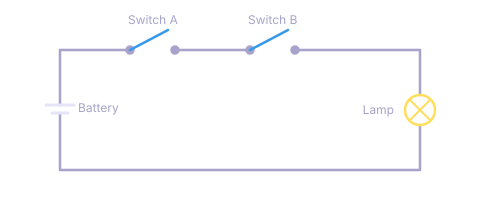
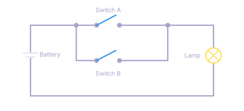
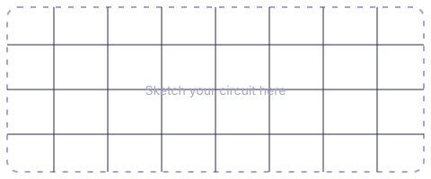

# Worksheet: AND &amp; OR circuits

**Name:** ______________________________ &nbsp;&nbsp; **Date:** ________________

## Part A — Series circuit

Wire the circuit below. **Predict first**, then flip the switches and record what the lamp does.

| Switch A | Switch B | My prediction | Lamp lights? |
| :---: | :---: | :---: | :---: |
| open | open | | |
| open | closed | | |
| closed | open | | |
| closed | closed | | |

**Pattern:** the lamp lights only when ____________________________________________.

## Part B — Parallel circuit

Rewire the same parts so each switch has its own branch.

| Switch A | Switch B | My prediction | Lamp lights? |
| :---: | :---: | :---: | :---: |
| open | open | | |
| open | closed | | |
| closed | open | | |
| closed | closed | | |

**Pattern:** the lamp lights when ____________________________________________.

## Part C — Name the logic

Match each circuit to a logic gate by writing **AND** or **OR**.

| Circuit | Logic gate |
| --- | :---: |
| Series | |
| Parallel | |

## Part D — Explain it

1. Why does opening one switch turn the lamp off in the series circuit but not in the parallel circuit?
2. A hallway light has two switches, one at each end, and either one can turn it on. Which circuit does that match?

## Challenge

Design a circuit with a third switch, **C**, where the lamp lights when **A and B are both closed**, or when **C is closed on its own**. Label each switch.

